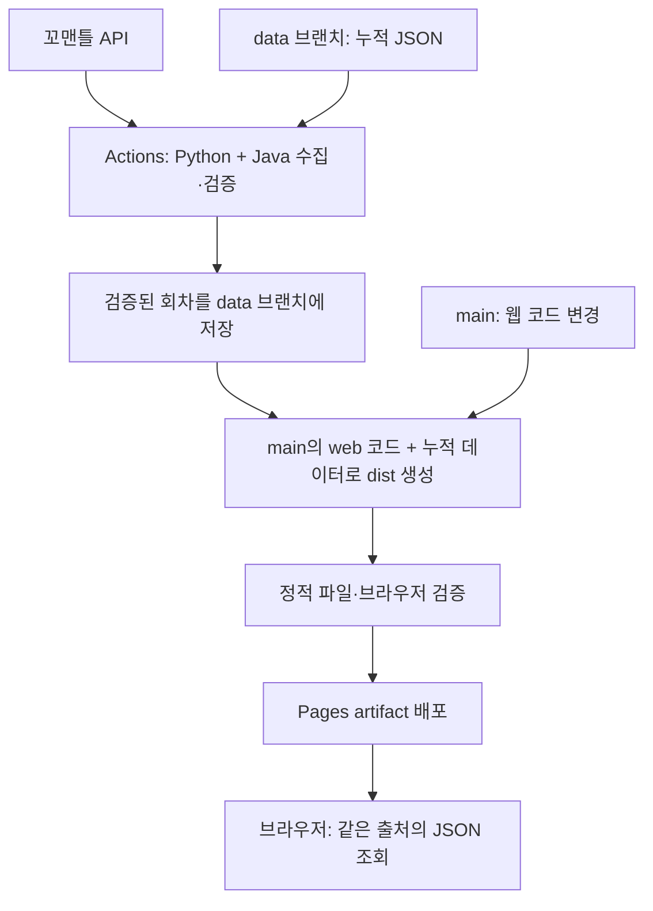

# GitHub Pages 웹 버전 구현 계획

작성일: 2026-10-24 (Asia/Seoul). 검토 기준: `5b4eedf`.

기존 [실행 검증 및 전환 검토](github-pages-review.md)를 구체적인 구현 계획으로 확장한 문서다.
이 문서는 구현 전 작성한 설계 기준이다. 후속으로 웹 UI·수집기·워크플로를 구현했으며,
실행과 복구 방법은 [웹 배포 운영 안내](github-pages-operations.md)에 정리했다.

## 1. 권장안과 판단 근거

**현재 Python CLI를 유지하고, GitHub Actions에서 회차별 데이터를 사전 생성하여
GitHub Pages의 정적 웹 화면에서 조회한다.**

| 영역 | 선택 | 이유 |
| --- | --- | --- |
| 웹 화면 | HTML + CSS + JavaScript ES modules | 회차·순위 선택과 힌트 공개 정도의 단일 화면에 충분하다 |
| 힌트 계산 | 기존 Python `Word`와 `WordManager` 재사용 | Okt 품사와 초성 등 현재 규칙을 유지한다 |
| 수집 환경 | Actions의 Python 3.12 + Java 21 | 로컬 검증 환경을 출발점으로 삼고 Ubuntu에서 호환성을 먼저 검증한다 |
| 데이터 영구 보관 | 별도 `data` 브랜치의 JSON | 매일 생성되는 데이터와 `main`의 코드 변경 이력을 분리한다 |
| 사이트 배포 | GitHub Actions의 Pages artifact 배포 | 코드와 보관 데이터를 합친 완성 디렉터리를 배포한다 |
| 방문자 런타임 | 브라우저만 필요 | Python·Java 설치와 별도 API 서버 운영이 필요 없다 |

[GitHub Pages는 정적 파일 호스팅](https://docs.github.com/en/pages/getting-started-with-github-pages/what-is-github-pages)이므로
Python CLI와 Java 분석기를 방문자 요청에 맞춰 실행할 수 없다.
[KoNLPy의 Java 의존성](https://konlpy.org/en/latest/install/)은 Actions의 데이터 생성 단계에서 처리한다.

기존 검토에서는 원본 API에 CORS 허용 헤더가 없었고, 과거 회차 조회 기간도 제한되어 있었다.
이는 기존 검토의 실측 결과를 근거로 하며, 이번 계획 작업에서 API를 다시 호출한 결과는 아니다.
브라우저의 직접 API 호출을 기본 설계에 넣지 않는다.
[CORS 설명](https://developer.mozilla.org/en-US/docs/Web/HTTP/Guides/CORS)

다른 선택지는 다음과 같이 판단한다.

| 대안 | 판단 |
| --- | --- |
| 브라우저에서 원본 API 직접 호출 | 현재 확인된 CORS 제약을 해결하지 못한다 |
| 브라우저에서 Python 실행 | Java 기반 Okt까지 옮기는 비용에 비해 이득이 작다 |
| 별도 API 서버·서버리스 프록시 | 가능하지만 일 단위 데이터에는 운영 범위가 커진다. 요청별 처리나 서버 차원의 정답 보호가 필요할 때 재검토한다 |
| React/Vue 등 프레임워크 | 현재 화면 규모에서는 필수가 아니다. 복잡한 기록 관리 등이 생길 때 검토한다 |

## 2. 현재 코드에서 유지할 동작

`main.py`의 `if __name__ == "__main__"` 가드 덕분에 수집기에서 import해도 CLI 입력이 시작되지 않는다.
1차 구현에서는 큰 패키지 재구성 없이 기존 클래스를 재사용한다.

| 현재 기능 | 웹 동작 |
| --- | --- |
| 오늘 회차 계산 | 한국 날짜를 기준으로 계산하고 보관 목록과 대조한다 |
| 회차 입력 | 실제 보관된 회차 중 선택한다 |
| 순위 0~1000 선택 | 0은 정답, 1~1000은 유사 단어 순위로 표시한다 |
| 품사 | 기존 Okt 규칙의 결과를 사전 생성하여 표시한다 |
| 초성 | Python이 계산한 결과를 JSON에 담아 표시한다 |
| 단어 길이 | 기존 Python `len(word)` 결과를 사용한다 |
| 유사도 | 원본 수치를 보관하고 화면 표시에서만 자릿수를 정한다 |
| 단어 전체 조회 | 사용자가 명시적으로 공개했을 때 표시한다 |
| `get_one_character()` | 웹에 글자 위치별 공개 기능을 추가한다. 현재 CLI 메뉴에는 없는 기능이다 |

품사는 명사·동사·형용사·부사·기타의 기존 분류를 유지한다.
여러 형태소로 나뉘어 원문 전체와 일치하는 토큰이 없으면 `기타`가 되는 규칙도 유지한다.
초성에서는 현재처럼 완성형 한글 이외의 문자를 건너뛴다.
예를 들어 단어 길이와 초성 문자열 길이가 다를 수 있으므로 둘을 같은 값으로 가정하지 않는다.

회차 계산은 공통 순수 함수로 추출한다.
한국 날짜에서 `2022-04-01`을 뺀 날짜 수를 회차로 사용하고,
회차의 날짜는 시작 날짜에 회차 수를 더해 얻는다. 기존 코드와 같이 기준일의 회차는 0이다.
`2026-10-24 → 1667`을 고정 검증 사례로 둔다.

## 3. 첫 배포의 기능 범위

### 반드시 포함할 기능

- 회차 선택: 날짜와 회차를 함께 표시하며 보관된 회차만 선택 가능.
- 순위 선택: 기본값은 `0 — 정답`, 숫자 입력 및 유효 범위 안내.
- 힌트 버튼: 길이, 품사, 초성, 유사도, 한 글자, 전체 단어.
- 모든 힌트는 초기에는 숨김. 회차나 순위를 변경하면 공개 상태 초기화.
- 한 글자 공개: 사용자에게는 1번째부터 표시하고 내부적으로 0부터 변환.
- 전체 단어 공개: 버튼을 누르면 확인 UI를 거쳐 공개. 취소 시 기존 상태 유지.
- 데이터 기준일 및 수집 시각 표시, 오늘 데이터가 없을 때 갱신 대기 안내.
- 로딩, 통신 실패, 데이터 형식 오류, 보관되지 않은 회차의 안내와 재시도.
- 모바일 대응, 키보드 조작, 레이블 및 포커스 처리.
- 원본 꼬맨틀과 GitHub 저장소 링크, 비공식 헬퍼임을 표시.

### 후속 기능

회차·순위를 담은 URL 공유, 힌트 사용 기록, 다크 모드, 단어 목록 필터링은 후속으로 둔다.
공유 URL을 추가하더라도 정답이나 공개한 힌트 내용은 URL에 넣지 않는다.
첫 배포에 로그인·DB·사용자 추측의 유사도 계산·전체 순위표 자동 공개는 포함하지 않는다.

### 화면 흐름

```text
꼬맨틀 헬퍼                         원본 게임 ↗
데이터: 2026-10-24 / 1667회 · 수집 시각

회차 [2026-10-24 · 1667회 ▼]
순위 [0      ]  0은 정답, 1~1000은 유사 단어

선택한 대상: 1667회 정답
[길이 보기] [품사 보기] [초성 보기] [유사도 보기]
[한 글자 보기]                 [전체 단어 보기]

사용자가 공개한 힌트만 이 영역에 표시
```

오늘 데이터가 있으면 오늘 회차를 선택한다. 없으면 가장 최근 보관 회차를 선택하되,
`오늘 회차는 갱신 대기 중이며 현재 YYYY-MM-DD 회차를 보고 있습니다`라고 표시한다.
이 상태를 오늘 데이터처럼 표시하지 않는다. 보관 데이터가 아예 없으면 안내와 재시도만 제공한다.

정답을 숨기는 목적은 의도하지 않은 노출 방지다.
초기 DOM의 숨겨진 텍스트, `title`, 접근성 레이블, 콘솔 로그에 단어를 미리 넣지 않는다.
단, 브라우저가 받는 JSON에는 단어가 포함되므로 개발자 도구 등으로 확인하는 것까지 막을 수는 없다.

## 4. 전체 데이터 흐름과 저장소 구조



`main` 브랜치의 제안 파일 구성:

```text
main.py                         # 기존 CLI 및 재사용할 도메인 로직
requirements.txt
web/
  index.html
  styles.css
  app.js                        # 화면·이벤트·공개 상태 관리
  data.js                       # manifest/회차 로드와 기본 형식 검사
  hints.js                      # 순위·글자 위치 등 순수 처리
scripts/
  __init__.py
  collect_data.py                # 수집·직렬화·완전성 검증·아카이브 갱신
  build_site.py                  # web + 아카이브 → dist
tests/
  test_main.py                  # 기존 회귀 테스트 유지
  test_live.py                   # 기존 명시적 실제 API 테스트
  test_collect_data.py
  test_build_site.py
  web/                          # JavaScript 단위·브라우저 시나리오
package.json                    # 웹 테스트용; 사이트 실행 자체에는 npm 불필요
.github/workflows/
  ci.yml
  publish-pages.yml
docs/
  github-pages-review.md
  github-pages-plan.md
```

`data` 브랜치는 생성 데이터만 보관한다. Pages의 브랜치 직접 배포 소스로 설정하지 않는다.

```text
manifest.json
operations.json                  # 마지막 성공 배포 정보; dist에는 포함하지 않음
rounds/
  1665.<content-hash>.json
  1666.<content-hash>.json
  1667.<content-hash>.json
```

배포 결과는 `dist/index.html`, `dist/*.js`, `dist/styles.css`,
`dist/data/manifest.json`, `dist/data/rounds/*.json`이다.
매번 전체 누적 데이터와 웹 자원을 함께 포함한다.
`dist/`, 로컬 아카이브 작업 폴더, 웹 테스트 결과물은 Git 추적에서 제외한다.

초성·품사·길이의 계산은 Python을 기준으로 한다. 웹에서 같은 계산을 이중 구현하지 않는다.
JavaScript의 한 글자 공개는 `Array.from(word)`로 코드 포인트 단위 배열을 사용하여
Python 문자열 인덱스와 맞춘다. 원문을 별도로 Unicode 정규화하여 바꾸지 않는다.
[Array.from 문서](https://developer.mozilla.org/en-US/docs/Web/JavaScript/Reference/Global_Objects/Array/from)

## 5. JSON 계약

### 회차 데이터

아래 단어와 점수는 설명용 예시이며 실제 1667회 정답이 아니다.
배열은 예시 한 행만 보인 것이고 실제 배포 파일은 1,001행이어야 한다.

```json
{
  "schema_version": 1,
  "round": 1667,
  "date": "2026-10-24",
  "timezone": "Asia/Seoul",
  "collected_at": "2026-10-24T00:07:00+09:00",
  "source": "https://semantle-ko.newsjel.ly/top_scores/1667",
  "analyzer": {"name": "Okt", "konlpy_version": "0.6.0", "rules_version": 1},
  "words": [
    {"rank": 0, "word": "사과", "pos": "명사", "initial_consonant": "ㅅㄱ", "length": 2, "similarity": 100.0}
  ]
}
```

### 목록 파일

```json
{
  "schema_version": 1,
  "timezone": "Asia/Seoul",
  "updated_at": "2026-10-24T00:07:00+09:00",
  "latest_round": 1667,
  "rounds": [
    {"round": 1667, "date": "2026-10-24", "path": "rounds/1667.<content-hash>.json", "word_count": 1001}
  ]
}
```

- `rounds`는 실제 보관 파일만 가리키며 회차 순서로 정렬한다. 연속된 회차라고 가정하지 않는다.
- `latest_round`는 보관한 가장 큰 회차이며, 브라우저가 계산한 오늘 회차와 별개다.
- 파일 경로의 해시는 최종 JSON 바이트를 기준으로 계산한다. 재수집하지 않은 기존 파일은 그대로 둔다.
- `updated_at`은 데이터 변경 때만 바꾼다. 실행할 때마다 의미 없는 커밋을 만들지 않는다.
- 웹은 알 수 없는 `schema_version`이면 오류를 안내한다. 다른 의미의 필드를 추측해서 표시하지 않는다.
- 유사도는 유한한 수여야 한다. JSON 출력 시 `allow_nan=False`를 사용한다.

## 6. 수집기와 영구 보관 정책

### 수집 대상

실행 시작 시 한국 날짜와 오늘 회차를 고정한다.
기존 검토에서 확인한 조회 범위를 기준으로 `오늘-2 ~ 오늘`의 누락 회차를 오래된 것부터 수집한다.
첫 실행도 이 범위로 시작한다. 음수 회차는 제외하고, API에서 조회 가능한 내일 회차는 수집하지 않는다.

원본 게임은 한국 자정에 정답이 바뀐다고 안내한다.
[원본 게임 FAQ](https://semantle-ko.newsjel.ly/)
수집 도중 날짜가 바뀌면 배포 직전 미래 회차 포함 여부와 기준 날짜를 다시 검증한다.
출시 전에는 최신 API의 허용 범위를 재확인하고, 조회 가능 범위를 상수로 관리한다.

수집 범위보다 오래된 누락 회차는 복구 불가 목록으로 보고하되 성공 데이터의 처리를 막지 않는다.
보관한 회차가 최신 제한 밖으로 벗어나도 삭제하지 않는다.
장기 장애로 API 조회 기간이 지나간 데이터는 이 구조만으로 복구할 수 없다.

### 회차별 검증

현재 `WordManager`는 일부 순위만 있는 응답도 허용하며 기존 테스트도 이를 이용한다.
CLI의 정책은 유지하고, **공개용 수집기에서 완전성을 더 엄격하게 검사한다.**

1. 순위 집합이 정확히 `0..1000`, 총 1,001개인지 검사.
2. 순위 중복, 빈 단어, 비유한 유사도, 범위 밖 유사도를 거부.
3. 0위 유사도는 현재 규칙처럼 100.0으로 기록.
4. 모든 단어의 품사를 계산하고 허용된 다섯 값인지 검사.
5. 길이와 초성이 기존 `Word` 계산 결과와 일치하는지 검사.
6. 날짜·회차 관계 및 실행일 이후의 미래 데이터가 없는지 검사.
7. 직렬화 후 다시 읽어 검증하고 최종 파일을 확정.

Okt 초기화나 특정 단어 분석에 실패하면 그 회차는 배포 가능한 파일로 인정하지 않는다.
실패한 분석을 모두 `기타`로 대체해 정상 데이터처럼 저장하지 않는다.

### 재시도와 멱등성

- HTTP timeout은 기존 15초를 기준으로 한다.
- timeout·연결 실패·429·5xx는 횟수와 총 시간을 제한하여 재시도한다. 429의 `Retry-After`도 상한 내에서 따른다.
- 404·422·잘못된 데이터 형식은 같은 실행에서 무한 반복하지 않는다. 회차별 사유를 남긴다.
- 단어마다 API를 호출하지 않는다. 회차당 응답 하나로 1,001개 단어를 처리한다.
- 이미 보관된 정상 회차는 건너뛴다. 수정은 명시적인 강제 재수집 옵션으로 처리한다.
- 강제 재수집도 기존 파일을 덮어쓰지 않고 새 해시 파일을 만든 뒤 manifest를 교체한다.

### 보관 확정과 실패 처리

회차 파일은 임시 파일에서 검증 후 확정하고, manifest는 확정된 파일만 참조한다.
새 파일과 manifest는 `data` 브랜치의 한 커밋에 함께 저장한다.
Actions cache나 만료되는 artifact를 유일한 과거 데이터 저장소로 사용하지 않는다.

일부 회차만 성공하면 성공한 회차는 보관한다. 예를 들어 그저께 수집 성공 후 오늘 수집이 실패해도,
그저께 데이터를 잃지 않도록 보관 단계를 실행한 다음 실행 결과를 실패로 보고한다.
수집기는 `saved_rounds`, `failed_rounds`, `today_available` 같은 구조화된 결과를 출력한다.
예상한 회차별 수집 실패는 이 결과로 전달하고, 보관 job을 실행한 뒤 최종 상태를 판정한다.
수집 프로세스의 실패 때문에 정상 수집분의 저장까지 자동으로 건너뛰는 job 의존성을 만들지 않는다.

정기 수집에서 오늘 파일이 없으면 기존 공개 사이트를 유지하고 새 배포는 생략한다.
오늘 파일이 정상이고 일부 과거 회차만 실패하면 오늘을 포함해 배포하고 누락을 실행 요약에 남긴다.
아카이브 저장 실패 시에는 신규 데이터 배포도 중단한다. 저장 성공 뒤 배포만 실패했다면,
다음 실행에서 보관 데이터를 그대로 사용해 배포를 복구할 수 있어야 한다.

## 7. GitHub Actions와 배포 설계

### 검증 워크플로: `ci.yml`

- PR 및 `main` 코드 변경에서 기존 Python 회귀 테스트, 수집기·빌드 테스트, 웹 테스트 실행.
- 외부 API가 필요 없는 고정 fixture로 실행한다. 실제 API 장애가 일반 PR 검증을 막지 않게 한다.
- PR에서는 `data` 브랜치 쓰기와 Pages 배포를 수행하지 않는다.
- 별도 호환성 검증에서 Ubuntu + Python 3.12 + Java 21로 실제 Okt를 시작하고 대표 단어 분석을 확인한다.
  로컬 macOS 검증만으로 Linux 호환성이 확인된 것으로 간주하지 않는다.

### 발행 워크플로: `publish-pages.yml`

| 실행 원인 | 수집 | 배포 |
| --- | --- | --- |
| 정기 실행 | 누락된 최근 회차 수집 | 오늘 데이터가 준비되면 배포 |
| `main` 웹·수집·배포 코드 변경 | 원칙적으로 보관 데이터 재사용 | 코드와 아카이브를 다시 빌드해 배포 |
| 수동 실행 | 입력 옵션에 따라 수집 또는 강제 재수집 | 수집 후 또는 기존 아카이브로 재배포 |

기본 예약은 **매일 00:07 및 01:07 KST**로 한다. 두 번째 실행은 수집·배포 실패 복구용이다.
오늘까지 필요한 회차가 모두 보관되어 있고 이미 배포한 코드 SHA와 데이터 식별자가 같으면
API 요청과 배포를 생략한다. 데이터 식별자는 manifest와 참조 파일의 내용으로 계산하며
`operations.json`의 변경은 제외한다.
배포 실패 후에는 같은 데이터라도 배포를 재시도한다. 첫 코드 배포 전에는 초기 수집을 수동 실행한다.

예약 설정 예시:

```yaml
on:
  schedule:
    - cron: '7 0,1 * * *'
      timezone: Asia/Seoul
  workflow_dispatch:
```

현재 Actions는 IANA timezone을 지원한다. 실제 수집기의 날짜 계산도 별도로 한국 시간으로 고정한다.
예약 실행은 지연·누락될 수 있으며 공개 저장소에서는 60일 비활성 시 중지될 수 있으므로
정확한 자정 배포를 보장하지 않는다. 수동 복구 방법과 오래된 데이터 표시가 필요하다.
[예약 실행 공식 문서](https://docs.github.com/en/actions/reference/workflows-and-actions/events-that-trigger-workflows#schedule)

수집과 발행의 전체 순서는 다음과 같다.

1. 발행 워크플로 전체에 공통 concurrency group을 적용하고 `cancel-in-progress: false`로 직렬화.
2. 실행 가능한 최신 `main` 코드와 현재 `data` 아카이브를 별도 디렉터리에 checkout.
   과거 이벤트의 실행이 뒤늦게 시작되어 구버전 UI를 다시 배포하지 않도록 발행 시점의 `main`을 사용.
3. 필요한 경우 Python·Java 준비 후 수집 및 검증. API 호출 없는 코드 배포에서는 이 단계를 생략.
4. 검증된 새 데이터를 `data` 브랜치에 저장. 데이터가 바뀌지 않았으면 커밋하지 않음.
5. 같은 코드 SHA에 대한 오프라인 검증을 수행하고 웹과 아카이브로 `dist/` 생성,
   링크·파일·브라우저 기본 동작 검사. 독립된 CI 실행이 끝나기 전에 검증 없이 발행하지 않음.
6. Pages artifact 업로드 및 배포.
7. 코드 SHA, 아카이브 commit SHA, 데이터 식별자, 수집 결과, 최신 회차, 배포 URL을 실행 요약에 기록.
8. 배포 성공 후 코드 SHA와 데이터 식별자를 `data` 브랜치의 `operations.json`에 기록.
   실패 시 성공 기록을 갱신하지 않음. 메타데이터 저장만 실패한 경우 다음 실행의 중복 배포는 허용.

소스·데이터의 두 checkout은 커밋 해시를 기록해 재현 가능하게 한다.
`data` 브랜치가 아직 없을 때만 최초 아카이브를 생성한다.
기존 브랜치의 접근 실패나 손상을 빈 아카이브로 간주하여 덮어쓰면 안 된다.
저장 충돌이 발생하면 최신 아카이브를 다시 읽어 병합·검증하고 제한 횟수만 재시도한다.
force push는 사용하지 않는다.

**중요:** `GITHUB_TOKEN`으로 데이터를 push했다고 별도 push 기반 배포 워크플로가
자동으로 실행될 것으로 기대하지 않는다. 동일 발행 워크플로 안에서 배포까지 명시적으로 연결한다.
[워크플로 재트리거 규칙](https://docs.github.com/en/actions/how-tos/write-workflows/choose-when-workflows-run/trigger-a-workflow)

### 권한과 저장소 설정

- Repository Settings → Pages → Source를 **GitHub Actions**로 설정.
- 수집·보관 job: 필요한 범위의 `contents: write`. 기본 브랜치는 수정하지 않고 `data` ref만 갱신하도록 구현.
  이 토큰 권한 자체가 브랜치 하나로 제한되는 것은 아니므로 workflow 코드와 브랜치 규칙으로 통제한다.
- 빌드 job: 원칙적으로 `contents: read`.
- 배포 job: `pages: write`, `id-token: write`, `github-pages` environment와 빌드 job에 대한 `needs`.
- 성공 기록 job: 배포 성공 후에만 실행하며 `contents: write`로 `operations.json`만 갱신.
- 기본 브랜치 보호를 해제할 필요는 없다. `data` 브랜치에 봇 쓰기가 허용되는지 별도로 확인.
- 저장소 정책이 토큰 쓰기를 막으면 저장 위치를 대안으로 재설계한다. PAT 추가를 기본 전제로 두지 않는다.
- Action 버전은 구현 시 공식 지원 버전을 확인하고 검증한 commit SHA에 고정한다.

[Pages custom workflow 공식 문서](https://docs.github.com/en/pages/getting-started-with-github-pages/using-custom-workflows-with-github-pages)

기본 도메인을 사용할 경우 예상 URL은 `https://testrapod.github.io/komantle-helper/`이다.
실제 활성화 여부와 배포 URL은 첫 배포에서 확인한다.

## 8. 브라우저 데이터 로드와 배포 경로

- 자원 경로는 `./styles.css`, `./app.js`, `./data/manifest.json`처럼 상대 경로를 사용한다.
- manifest의 `path`는 manifest URL을 기준으로 해석한다. `/data/...` 같은 도메인 루트 경로는 쓰지 않는다.
- 단일 `index.html` 화면으로 만들며 서버 rewrite가 필요한 경로 라우팅을 추가하지 않는다.
- manifest를 먼저 받고 선택 회차 JSON 한 개만 요청한다. 모든 과거 데이터를 한꺼번에 다운로드하지 않는다.
- manifest는 `cache: "no-cache"`로 재검증 요청하고 회차 파일은 내용 해시가 붙은 경로로 읽는다.
- 수정 전 파일도 유지해 이전 manifest를 읽은 방문자의 요청이 깨지지 않도록 한다.
- 배포 경계나 캐시 지연으로 파일을 못 읽으면 manifest를 다시 읽은 뒤 한 번 재시도한다.
- 회차를 빠르게 변경하면 이전 요청을 취소하거나 요청 ID로 오래된 응답을 무시한다.
- 데이터를 읽는 중에는 이전 회차의 공개 힌트를 지우고 현재 선택에 대한 로딩 상태를 표시한다.
- 원본 문자열은 `textContent`로 삽입한다. HTML로 해석하지 않는다.
- 한국 날짜는 `Intl.DateTimeFormat`의 `timeZone: "Asia/Seoul"`을 기준으로 구하고,
  시간대가 다른 사용자의 로컬 자정을 오늘 회차 기준으로 사용하지 않는다.
- 장시간 열어둔 화면은 탭 복귀 시 기준 날짜와 manifest를 다시 확인한다.
  자동 갱신으로 사용 중인 과거 회차를 바꾸거나 숨긴 힌트를 공개하지 않는다.
- 첫 버전에서는 Service Worker를 추가하지 않아 갱신 경로를 단순하게 유지한다.

## 9. 테스트와 배포 완료 기준

이번 검토에서 `.venv/bin/python -m unittest discover -s tests -v`를 실행했고,
오프라인 22개 통과, 실제 API 테스트 1개 건너뜀을 확인했다. 실제 API·Java 전체 검증은 다시 실행하지 않았다.

| 영역 | 반드시 검증할 사례 |
| --- | --- |
| 기존 CLI | 기존 22개 회귀 테스트와 `python main.py`의 기본 흐름 유지 |
| 날짜 | 기준일·1667회·UTC/KST 날짜 경계·월말/연말·다른 사용자 시간대 |
| 공개 데이터 | 순위 누락·중복·NaN·빈 단어·미래 회차·품사 실패 시 배포 파일 생성 거부 |
| 누적 보관 | 이전 회차 유지·중간 누락·중복 실행 무변경·강제 수정 시 이전 파일 유지 |
| 실패 복구 | 일부 수집 성공·저장 실패·저장 후 배포 실패·다음 실행 복구 |
| 프런트엔드 | 0/1000위·잘못된 입력·글자 경계·보충 문자·회차 변경 시 공개 상태 초기화 |
| 브라우저 | 클릭 전 단어 미노출·전체 공개 취소·오류/재시도·빠른 회차 변경의 응답 역전 |
| 배포 경로 | `/komantle-helper/` 하위에서 JS/CSS/JSON 모두 정상 로드 |
| 접근성·모바일 | 좁은 화면 가로 넘침 없음·키보드 완료·스크린리더 레이블·포커스 유지 |
| 운영 | Actions runner의 API 접근·Java 실행·data push·Pages 배포·수동 재배포 |

Python은 기존 `unittest`를 확장한다. JavaScript의 순수 로직은 [Node 내장 테스트](https://nodejs.org/api/test.html)로,
실제 UI 흐름은 [Playwright](https://playwright.dev/docs/intro)의 핵심 시나리오로 검증한다.
실제 API 접근과 실제 Okt 테스트는 고정 fixture 테스트와 구분해 실행한다.
Playwright는 개발·CI 도구이며 정적 사이트에 런타임 의존성으로 포함하지 않는다.

프로젝트 경로 검증은 로컬에서도 `/komantle-helper/`에 파일을 두고 수행한다.
루트 경로에서만 성공한 로컬 테스트를 Pages 검증으로 대체하지 않는다.
최초 공개 후 실제 URL에서도 오늘/지난 회차와 모바일 화면을 확인한다.

## 10. 구현 순서와 단계별 완료 조건

| 단계 | 작업 | 완료 조건 |
| --- | --- | --- |
| 0. 실행 가능성 확인 | 원본 데이터 재배포 범위 조사, Actions runner의 API·Java 소규모 검증, Pages/토큰 정책 확인 | 배포 구조를 막는 제약을 확인하고 해결 방향 확정 |
| 1. 데이터 계약·수집기 | 날짜 공통 함수, JSON 생성, 완전성 검사, 누적 보관, 오류·재시도 | fixture 및 실제 현재 회차로 재실행 가능한 JSON 생성 |
| 2. 웹 UI | 회차·순위 선택, 여섯 힌트, 공개 상태, 오류·모바일·접근성 | fixture로 모든 사용자 흐름과 하위 경로 테스트 통과 |
| 3. 빌드·자동화 | data checkout/commit, dist 생성, CI, 수집·배포 연결 | 수동 실행으로 저장과 Pages 배포가 끝까지 성공 |
| 4. 출시 검증·문서 | 실제 API 전체 회차 검증, 실사이트 확인, 운영·복구 문서 | 오늘·지난 회차 정상, 실패 복구 검증, 실행 방법 문서화 |
| 5. 예약 운영 검증 | 다음 날 예약 실행 및 예비 실행 확인 | 새로운 날짜의 JSON이 추가되고 기존 회차가 유지됨 |

권장 변경 묶음은 `수집기와 계약 → 웹 화면 → 자동화와 운영 문서`의 세 개다.
1단계와 2단계는 동일 JSON fixture를 사용해 개발할 수 있고, 3단계에서 실제 파이프라인으로 연결한다.
단계 5는 다음 한국 날짜가 되어야 검증 가능하므로 첫 수동 배포 성공과 일일 운영 검증 완료를 구분한다.

## 11. 운영·규모·공개 전 확인 사항

### 장애와 복구

- API 장애: 기존 공개 사이트 유지, Actions 실패 요약 확인 후 수동 재수집.
- 오늘 데이터 지연: 화면에 기준 날짜를 표시하고 01:07 KST 예비 실행으로 재시도.
- 잘못된 데이터 발견: 기존 정상 데이터 유지 또는 특정 회차 강제 재수집 후 새 파일·manifest 배포.
- UI 오류: 이전 정상 코드 SHA와 현재 정상 아카이브로 재배포.
- 데이터 오류: `data` 브랜치의 정상 스냅샷을 기준으로 복원하고 재배포. 과거 파일을 성급히 삭제하지 않음.
- 장기 중단: 수집 가능 기간의 누락만 복구하고 나머지는 보관되지 않았음을 명시.

실행 요약에는 회차·개수·상태·시각 위주로 기록하고 정답 목록 전체는 로그에 출력하지 않는다.
정적 페이지에는 최근 성공 데이터 시각만 알 수 있으므로, 모든 예약 실행 자체가 중단되면
Actions 실패 알림이 오지 않을 수 있다. 화면의 오래된 날짜 안내와 수동 점검을 기본 대응으로 둔다.
자동 가동 확인까지 필요해지면 저장소 밖의 모니터를 별도 운영 항목으로 추가한다.

### 저장 용량

실제 1회차 JSON 크기를 먼저 측정하고 연간 증가량을 계산한다.
예를 들어 파일당 150~250KB라면 365회차의 배포 데이터는 약 55~91MB다.
이는 실측값이 아닌 산정 예시이며 Git 이력 크기는 별도다.
[Pages의 게시 사이트 용량 한도는 1GB](https://docs.github.com/en/pages/getting-started-with-github-pages/github-pages-limits)이므로
용량을 관찰하고 장기 보관 분리 여부를 이후 결정한다. 현재 규모에서 DB를 먼저 도입할 필요는 없다.

### 공개 데이터 범위

기존 검토에서 제시한 원본 서비스의 이용 조건·재배포 가능 범위 확인은 출시 전 작업에 포함한다.
현재 읽은 원본 게임 페이지에서는 회차 JSON 전체의 재배포 허용 여부를 확정할 근거를 찾지 못했다.
확인이 필요하면 운영자에게 문의할 내용을 준비하되, 이 계획 작업에서는 외부 메시지를 보내지 않는다.
이 확인과 무관한 수집기·UI 개발은 합성 fixture로 진행할 수 있다.

정답 JSON을 공개하는 제품 성격과 비공식 헬퍼임을 사이트에 짧게 설명한다.
방문자의 정답을 실제로 비밀로 유지해야 하는 요구가 생기면 정적 Pages만으로는 충족할 수 없으므로
그때 서버 API 도입을 별도로 설계한다.

## 12. 최종 완료 정의

1. 방문자가 Python·Java 설치 없이 실제 Pages URL에서 힌트를 사용할 수 있다.
2. 기존 CLI 기능과 품사 분류 규칙이 유지된다.
3. 오늘과 보관된 지난 회차를 선택할 수 있고, 보관되지 않은 회차는 명확히 안내한다.
4. 순위·회차 변경과 데이터 오류가 정답의 의도하지 않은 노출을 일으키지 않는다.
5. 다음 날 데이터가 자동 추가되어도 과거 회차가 남는다.
6. 수집·배포 장애 때 기존 사이트가 유지되고 수동 복구 절차가 검증되어 있다.
7. 저장·배포 권한, 데이터 공개 범위, 운영 방법이 문서화되어 있다.
